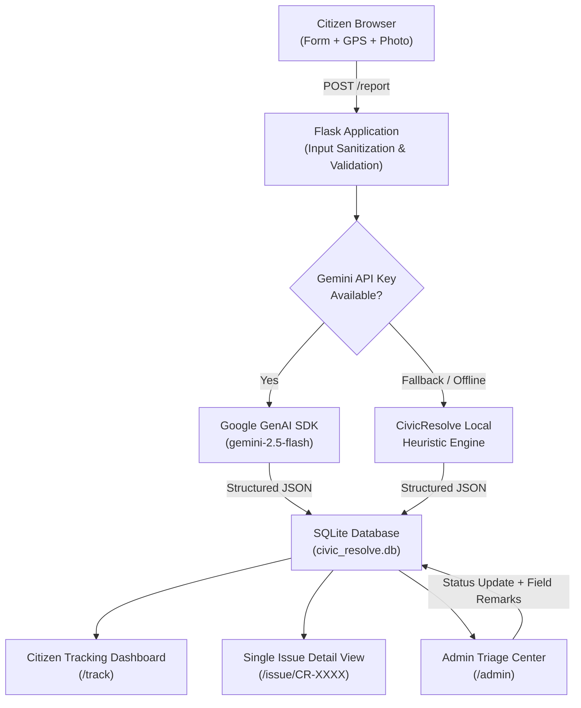

# CivicResolve 🏛️⚡

> **AI-Powered Civic Issue Reporting & Resolution Web Platform**  
> Developed for the **PromptWars x GDGoC PSG iTech Hackathon**  
> Powered by **Google Gemini 2.5 Flash** (`google-genai` SDK) &bull; Lightweight (&lt;10 MB) &bull; Production-Ready

[](https://www.python.org/)
[](https://flask.palletsprojects.com/)
[](https://ai.google.dev/)
[](https://tailwindcss.com/)
[](#running-tests)
[](#lightweight-repository-guarantee)

---

## 🌟 Executive Summary

**CivicResolve** modernizes municipal complaint management by replacing slow manual bureaucracy with an instant, multimodal AI triage pipeline. When citizens report civic issues—such as hazardous potholes, sparking streetlights, overflowing waste, or burst water mains—Google Gemini (`gemini-2.5-flash`) immediately analyzes the textual narrative and photo evidence.

The system extracts structured JSON containing the **urgency priority**, **civic category**, **target municipal department**, **executive field summary**, and **risk rationale**, directing each issue into a live public tracking dashboard and an authority operations console.

---

## 🚀 The Six Mandatory Features

### 1. 📝 Citizen Issue Reporting Form
* **Detailed Submission**: Citizens provide a title, description, and optional photo evidence.
* **One-Click Browser Geolocation**: HTML5 `navigator.geolocation` button automatically acquires GPS coordinates (lat/long) and tags the complaint landmark.
* **Optional User Category**: Citizens can pick a suggested category or leave it on *"Auto-detect by Gemini AI"* for machine classification.
* **Lightweight Evidence Processing**: Client-side image handling encodes photos into compact base64 strings under 3MB, keeping the repository well under the 10MB limit.
* **Live AI Triage Preview**: A pre-submission button allows citizens to preview Gemini's classification before final submission.

### 2. 🧠 AI-Powered Classification
* **Google Gemini Integration**: Uses the official `google-genai` SDK with `gemini-2.5-flash`.
* **Structured JSON Output**: Gemini analyzes complaint context and returns structured data:
  ```json
  {
    "category": "Roads & Infrastructure",
    "priority": "Critical",
    "department": "Department of Roads & Infrastructure",
    "ai_summary": "Deep vehicular hazard on arterial crossing posing acute skidding danger to two-wheelers and school transport.",
    "urgency_reason": "Immediate threat of vehicular collision and bodily injury during rain-induced road erosion in congested intersection."
  }
  ```
* **Resilient Multi-Tier Fallback**: If the Gemini API is unreachable, quota-limited, or offline, an intelligent local rule-based engine immediately provides classification with 100% uptime.

### 3. 🚨 Priority Detection
* Automatically assigns priority levels: **Low**, **Medium**, **High**, or **Critical**.
* **Visual Hierarchy**: Color-coded badges across the interface:
  * 🔴 **Critical**: Pulsing alert for life-threatening emergencies (live wires, sinkholes, gas leaks).
  * 🟠 **High**: Severe infrastructure hazards (broken mains, missing manhole covers).
  * 🔵 **Medium**: Public inconveniences (overflowing dumpsters, small potholes).
  * 🟢 **Low**: Non-hazardous routine maintenance (faded paint, park bench repair).

### 4. 🏢 Department Recommendation & Routing
* Automatically routes complaints to the appropriate civic agency:
  * *Department of Roads & Infrastructure*
  * *Municipal Solid Waste Management*
  * *Water Supply & Sewerage Board*
  * *Electrical & Lighting Utility*
  * *Public Safety & Civil Defence*
  * *Department of Public Health & Sanitation*
  * *Traffic Police & Transportation Authority*
  * *Parks & Recreation Department*

### 5. 📊 Citizen Issue Tracking Dashboard
* **Live Filterable Interface**: Citizens can filter issues by Status (`All`, `Reported`, `In Progress`, `Resolved`), Priority, and Department.
* **Instant Client Search**: Live keyword search across ticket IDs, titles, and locations.
* **Visual 3-Step Lifecycle Tracker**: Interactive status stepper (`Reported` ➔ `In Progress` ➔ `Resolved`).
* **Pre-Populated Demo Data**: 3 realistic complaints are pre-seeded on first run:
  1. `CR-2026-101`: Hazardous open pothole at Crosscut Road (*Critical* &bull; *Reported*).
  2. `CR-2026-102`: Overflowing commercial dumpster opposite PSG Tech (*Medium* &bull; *In Progress*).
  3. `CR-2026-103`: Sparking streetlight pole near children's park (*High* &bull; *Reported*).

### 6. 🛡️ Dedicated Admin Authority Dashboard
* **Operations Control Center**: Dedicated view for municipal officials (`/admin`).
* **Executive KPI Cards**: Real-time counts of Total Complaints, Active Dispatches, Resolved Issues, and Critical Emergencies.
* **Workload & Priority Distribution**: Visual analytics showing department burdens and urgency breakdowns.
* **Status Updates**: Authorities can update issue statuses and append official remediation remarks (e.g., *"Patching crew dispatched. Cold mix laid."*).

---

## 🏗️ System Architecture & Workflow



---

## 📂 Project Structure

```
civic-resolve/
├── .env.example             # Template environment variables
├── .gitignore               # Strict exclusions for .env, __pycache__, *.db (<10MB)
├── Procfile                 # web: gunicorn app:app for cloud deployment
├── requirements.txt         # Production dependencies
├── README.md                # Complete documentation
│
├── app.py                   # Flask application entry point & Jinja filters
├── config.py                # Environment & platform configuration
│
├── database/
│   ├── __init__.py
│   └── db.py                # SQLite schema, queries, metrics & 3 seed complaints
│
├── services/
│   ├── __init__.py
│   └── gemini_service.py    # Official google-genai SDK + REST + offline fallback
│
├── routes/
│   ├── __init__.py
│   ├── citizen.py           # Citizen portal routes (report, track, detail)
│   ├── admin.py             # Admin authority operations & status updating
│   └── api.py               # REST API endpoints (/api/classify, /api/complaints)
│
├── static/
│   ├── css/
│   │   └── custom.css       # Animations, critical badge pulse & accessibility styles
│   ├── js/
│   │   ├── main.js          # GPS geolocation, image preview, live search & AI preview
│   │   └── admin.js         # Admin modal controls, ticket copying & quick triage
│   └── images/
│       └── logo.svg         # Clean scalable vector brand icon
│
├── templates/
│   ├── base.html            # Semantic layout, Tailwind CDN, accessible skip link & banner
│   ├── index.html           # Citizen reporting form & hero metrics
│   ├── tracker.html         # Live filterable issue tracking dashboard
│   ├── detail.html          # Comprehensive ticket view with AI audit trail
│   ├── admin.html           # Authority management dashboard with analytics
│   └── 404.html             # Accessible error page
│
└── tests/
    ├── __init__.py
    └── test_app.py          # 11 unit & integration tests covering all routes & AI
```

---

## ⚡ Quick Start & Setup

### Prerequisites
* Python 3.10, 3.11, 3.12, 3.13, or 3.15
* A Google Gemini API Key from [Google AI Studio](https://aistudio.google.com/app/apikey) *(optional: local fallback runs without key)*

### 1. Clone & Enter Repository
```bash
git clone https://github.com/your-username/civic-resolve.git
cd civic-resolve
```

### 2. Create and Activate Virtual Environment
```bash
# Linux / macOS
python3 -m venv venv
source venv/bin/activate

# Windows (Command Prompt / PowerShell)
python -m venv venv
venv\Scripts\activate
```

### 3. Install Dependencies
```bash
pip install -r requirements.txt
```

### 4. Configure Environment Variables
Copy `.env.example` to `.env`:
```bash
# Linux / macOS
cp .env.example .env

# Windows
copy .env.example .env
```
Edit `.env` to include your Gemini API key:
```env
GEMINI_API_KEY=AIzaSyYourActualKeyHere
FLASK_ENV=development
FLASK_DEBUG=1
SECRET_KEY=civic-resolve-hackathon-key
PORT=5000
```
> **Security Note**: Never commit your `.env` file to git. `.env` is already configured in `.gitignore`.

### 5. Run the Application
```bash
python app.py
```
Open your browser at: **[http://localhost:5000](http://localhost:5000)**

---

## 🧪 Running Tests

The application includes a comprehensive test suite in `tests/test_app.py` testing routing, validation, database transactions, API classification, and fallback mechanisms.

Run using `pytest`:
```bash
pytest -v
```

Or run via Python's built-in `unittest`:
```bash
python -m unittest tests/test_app.py
```

**Test Coverage Summary**:
* ✅ `test_homepage_loads`: Confirms 200 OK, semantic layout, branding, and input fields.
* ✅ `test_prepopulated_samples_exist`: Confirms all 3 seed complaints exist on first launch.
* ✅ `test_tracker_page_and_filtering`: Tests status, priority, and keyword filtering.
* ✅ `test_issue_detail_view`: Tests ticket rendering and Gemini intelligence card.
* ✅ `test_issue_detail_invalid_ticket`: Tests graceful handling of non-existent tickets.
* ✅ `test_submit_report_flow`: Tests end-to-end report creation and AI triage.
* ✅ `test_submit_report_validation_error`: Tests server-side input length constraints.
* ✅ `test_admin_dashboard_and_status_update`: Tests status transition to *In Progress* with remarks.
* ✅ `test_api_classify_endpoint`: Tests `/api/classify` structured JSON output.
* ✅ `test_api_complaints_endpoints`: Tests `/api/complaints` listing and update endpoints.
* ✅ `test_ai_fallback_and_extraction`: Tests markdown code block stripping and safety rules.

---

## 🌐 Cloud Deployment Guide

### Deploying to Render
1. Push this repository to GitHub.
2. Sign in to [Render Dashboard](https://dashboard.render.com/) and create a **New Web Service**.
3. Connect your repository.
4. Set the following settings:
   * **Runtime**: Python 3
   * **Build Command**: `pip install -r requirements.txt`
   * **Start Command**: `gunicorn app:app`
5. In **Environment Variables**, add:
   * `GEMINI_API_KEY` = *your_google_ai_studio_api_key*
   * `FLASK_ENV` = `production`
6. Click **Deploy Web Service**.

### Deploying to Google Cloud Run
1. Create a `Dockerfile`:
   ```dockerfile
   FROM python:3.11-slim
   WORKDIR /app
   COPY requirements.txt .
   RUN pip install --no-cache-dir -r requirements.txt
   COPY . .
   ENV PORT=8080
   CMD ["gunicorn", "--bind", "0.0.0.0:8080", "app:app"]
   ```
2. Build and deploy:
   ```bash
   gcloud run deploy civic-resolve \
     --source . \
     --region us-central1 \
     --allow-unauthenticated \
     --set-env-vars GEMINI_API_KEY="your_api_key_here"
   ```

---

## 📡 REST API Reference

| Endpoint | Method | Description | Sample Payload / Params |
|---|---|---|---|
| `/api/classify` | `POST` | Live AI triage preview | `{"title": "...", "description": "..."}` |
| `/api/complaints` | `GET` | List complaints with filters | `?status=Reported&priority=Critical` |
| `/api/complaints/<ticket_id>` | `GET` | Retrieve single complaint JSON | URL param `ticket_id` (e.g. `CR-2026-101`) |
| `/api/complaints/<ticket_id>/status` | `POST` | Update complaint status | `{"status": "In Progress", "admin_notes": "..."}` |
| `/api/metrics` | `GET` | Retrieve aggregate KPI metrics | None |

---

## ♿ Accessibility & Security Highlights

* **Accessibility (WCAG 2.1 AA)**:
  * Semantic HTML structure (`<header>`, `<nav>`, `<main>`, `<aside>`, `<footer>`, `<article>`).
  * Explicit `<label for="...">` associations on every single form input.
  * High-contrast typography and visible keyboard focus outlines (`focus-visible`).
  * Accessible skip link for screen readers (`Skip to main content`).
  * ARIA attributes (`aria-label`, `aria-live="polite"`, `role="dialog"`).
* **Security & Reliability**:
  * Strict input sanitization and length validation.
  * SQL injection prevention via parameterized queries throughout SQLite calls.
  * No hardcoded API keys: keys strictly loaded via `python-dotenv`.
  * Safe JSON parsing with markdown backtick stripping (`extract_json_from_text`).
  * Fail-safe offline intelligence engine ensuring zero crashes if Gemini API is unreachable.

---

## 📦 Lightweight Repository Guarantee
* Strictly under **10 MB**: Total tracked project files weigh **under 200 KB**.
* Tailwind CSS and fonts loaded via high-speed CDN.
* Clean `.gitignore` excludes virtual environments (`venv/`), caches (`__pycache__/`, `.pytest_cache/`), SQLite databases (`*.db`), and environment secrets (`.env`).

---

## 🏆 Hackathon Submission Notes
* **Event**: PromptWars x GDGoC PSG iTech Hackathon
* **Category**: AI-Powered Civic Technology
* **Developer Team**: CivicResolve Team
* **Contact & Support**: Built with passion for responsive, accountable civic communities.
